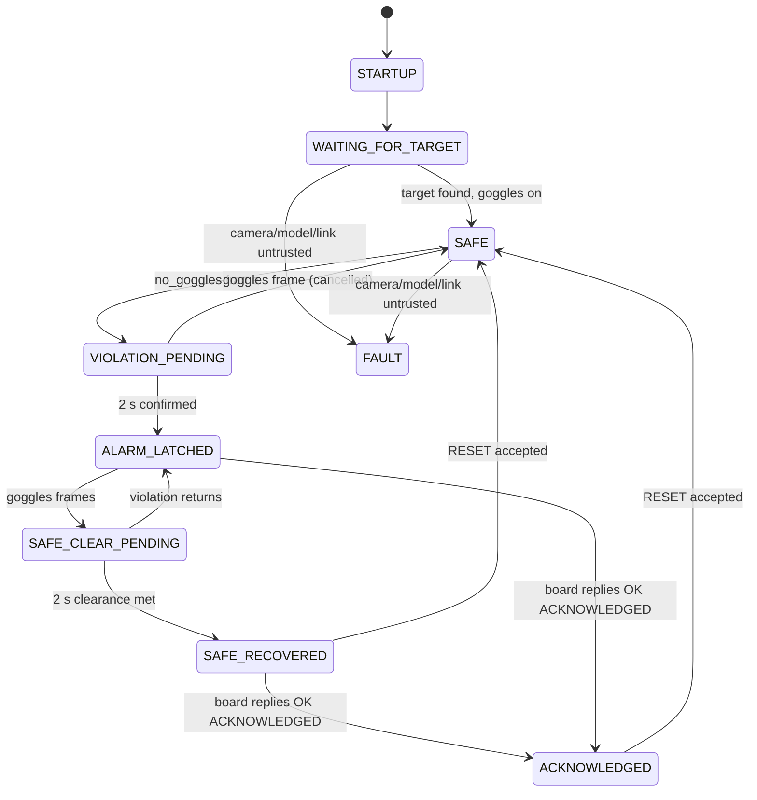

# SYSTEM STATE REFERENCE — Intended Lifecycle

Reference description of the lifecycle the build is **meant** to implement.
It states intent, not observed behaviour. The one place where the two still
diverge is logged as `B-01` in [FINAL_WORKING_VERSION.md](./FINAL_WORKING_VERSION.md).

Sources of truth:

- Laptop policy: `tools/incident_lifecycle.py` (`OperatorState`, `Event`, `ResetBlocker`)
- Board state machine: `firmware/esp32_eye_shield_monitor/incident_core.h`
- Serial contract: `docs/protocol.md`

Two invariants govern every row below:

1. **The alarm is sticky.** Once latched, nothing clears it except a fully
   conditioned reset. Missing detections never clear it.
2. **UNKNOWN is never SAFE.** A missing detection is missing information. It may
   hold or cancel a pending confirmation; it may never manufacture a safe verdict.

---

## Transition overview

Note the two inbound edges to `ACKNOWLEDGED`: acknowledging before recovery and
acknowledging after recovery are both valid, and both converge on the same
state. Reset acceptance is what returns the system to green.

---

## State table

| State | UI colour | Green LED | Red LED | Buzzer | Incident status | Serial posture |
|---|---|---|---|---|---|---|
| `STARTUP` | grey | off | off | off | none | link not yet trusted |
| `WAITING_FOR_TARGET` | grey | off | off | off | none | `HEARTBEAT` only |
| `SAFE` | green | **on** | off | off | none | `NO_INCIDENT <id>` |
| `VIOLATION_PENDING` | amber | **on** (still safe) | off | off | pending, not latched | `HEARTBEAT` only |
| `ALARM_LATCHED` | red | off | **on** | **on** | open, unanswered | `INCIDENT <id>` |
| `SAFE_CLEAR_PENDING` | red | off | **on** | **on** | open, unanswered | `HEARTBEAT` only |
| `SAFE_RECOVERED` | red/amber | off | **on** | **on** | open, unanswered, recovery proven | `RESET_READY <id>` |
| `ACKNOWLEDGED` | orange | off | **on** | **off** | open, answered | `ACKNOWLEDGE <id>` |
| `RESET` (→ `SAFE`) | green | **on** | off | off | closed | `RESET` |
| `FAULT` | magenta | off | off | off | none (board reports `Fault`) | link declared untrusted |

`RESET` is not a resting state — it is the acceptance of a reset that returns the
system to `SAFE`. It is listed separately because the task specification names it.

UI colours follow the dashboard palette: green `#1f9d55`, amber `#d98b00`,
red `#c62828`, orange `#ef6c00`, grey `#6b7280`, magenta `#8e24aa`.

---

## Per-state detail

### `STARTUP`

- **UI colour:** grey
- **Green LED:** off · **Red LED:** off · **Buzzer:** off
- **Incident status:** none
- **Allowed transitions:** → `WAITING_FOR_TARGET` once camera, model and serial
  link have each individually proven healthy.
- **Note:** no verdict is rendered before all three subsystems are confirmed.

### `WAITING_FOR_TARGET`

- **UI colour:** grey
- **Green LED:** off · **Red LED:** off · **Buzzer:** off
- **Incident status:** none
- **Allowed transitions:** → `SAFE` (target found wearing goggles) ·
  → `FAULT` (camera/model/link untrusted).
- **Note:** an empty frame is *not* safe. It parks here and never becomes `SAFE`.

### `SAFE`

- **UI colour:** green
- **Green LED:** **on** · **Red LED:** off · **Buzzer:** off
- **Incident status:** none
- **Allowed transitions:** → `VIOLATION_PENDING` (a `no_goggles` frame) ·
  → `WAITING_FOR_TARGET` (target lost) · → `FAULT`.
- **Note:** green is the only state the operator may read as compliant.

### `VIOLATION_PENDING`

- **UI colour:** amber
- **Green LED:** **on** (compliance is not yet withdrawn) · **Red LED:** off ·
  **Buzzer:** off
- **Incident status:** pending — a timer is running, nothing is latched
- **Allowed transitions:** → `SAFE` (goggles reappear; event
  `VIOLATION_CANCELLED`) · → `ALARM_LATCHED` (2.0 s of continuous violation).
- **Note:** this is the temporal filter. A single noisy frame can never alarm.

### `ALARM_LATCHED`

- **UI colour:** red
- **Green LED:** off · **Red LED:** **on** · **Buzzer:** **on**
- **Incident status:** open, unanswered
- **Allowed transitions:** → `SAFE_CLEAR_PENDING` (goggles observed) ·
  → `ACKNOWLEDGED` (board replies `OK ACKNOWLEDGED <id>`) · → `FAULT`.
- **Note:** the latched state is held indefinitely. Heartbeats, `SAFE`,
  `NO_INCIDENT` or any diagnostic preset must **not** return it to green.

### `SAFE_CLEAR_PENDING`

- **UI colour:** red
- **Green LED:** off · **Red LED:** **on** · **Buzzer:** **on**
- **Incident status:** open, unanswered
- **Allowed transitions:** → `ALARM_LATCHED` (violation returns; event
  `SAFE_CLEAR_CANCELLED`) · → `SAFE_RECOVERED` (2.0 s of continuous compliance).
- **Note:** seeing goggles does not itself clear the alarm; it starts a
  clearance timer that can be interrupted by a renewed violation.

### `SAFE_RECOVERED`

- **UI colour:** red/amber
- **Green LED:** off · **Red LED:** **on** · **Buzzer:** **on**
- **Incident status:** open, unanswered, recovery proven
- **Allowed transitions:** → `ACKNOWLEDGED` (board replies `OK ACKNOWLEDGED`) ·
  → `ALARM_LATCHED` (violation returns, re-arm) · → `SAFE` via `RESET`.
- **Note:** recovery is *evidence*, not clearance. Red and buzzer persist until a
  human acts.

### `ACKNOWLEDGED`

- **UI colour:** orange
- **Green LED:** off · **Red LED:** **on** · **Buzzer:** **off**
- **Incident status:** open, answered
- **Allowed transitions:** → `SAFE` via `RESET` (all five reset preconditions
  satisfied) · → `ALARM_LATCHED` (violation returns; event `ALARM_REARMED`,
  the buzzer and confirmation timer restart).
- **Note:** acknowledge silences the buzzer only. It never touches green, and it
  only becomes true once the board has answered `OK ACKNOWLEDGED <id>` — a local
  keypress is a *request*. An `OK HEARTBEAT` reply must never complete an
  acknowledge.

### `RESET` (acceptance → `SAFE`)

- **UI colour:** green
- **Green LED:** **on** · **Red LED:** off · **Buzzer:** off
- **Incident status:** closed
- **Allowed transitions:** → `SAFE`.
- **Preconditions, checked in this order (`ResetBlocker`):**
  1. `NO_INCIDENT` — an incident is actually open
  2. `NOT_ACKNOWLEDGED` — the board confirmed the acknowledge
  3. `NOT_SAFE_RECOVERED` — recovery proven, including the on-board verification
     stamp for *this* incident
  4. `HEALTH_INVALID` — camera/model health still good
  5. `LINK_INVALID` — serial link healthy (board refuses `RESET` otherwise)
- **Note:** the board enforces the same gate; `RESET` is refused when
  `linkHealthy()` is false.

### `FAULT`

- **UI colour:** magenta
- **Green LED:** off · **Red LED:** off · **Buzzer:** off
- **Incident status:** none — the board is driven to its `Fault` output
  (both LEDs and buzzer off) because the laptop can no longer be trusted
- **Allowed transitions:** → `STARTUP` after the fault is cleared and every
  subsystem re-verifies.
- **Note:** fail-quiet, not fail-green. Ambiguous hardware must never show green.

---

## Board-side mapping

`incident_core.h` renders the laptop's decision onto pins. Its output table is
the authority for the physical columns above:

| Core state | Green | Red | Buzzer |
|---|---|---|---|
| `Safe` | on | off | off |
| `AlarmLatched` | off | on | **on** |
| `Silenced` / `Acknowledged` / `ReadyToReset` | off | on | off |
| `Fault` | off | off | off |

The board's heartbeat timeout is 3000 ms; the laptop sends `HEARTBEAT` every
1000 ms, so the link stays healthy with two missed-beat tolerance.

---

## Where this reference stands against reality

- `B-01` (open): the board can return to green after `ALARM_LATCHED` while the
  laptop still reports `ACKNOWLEDGED: YES`, and an `OK HEARTBEAT` reply has been
  observed completing an acknowledge. The table above is the **intended**
  behaviour, and the in-progress change in the working tree is what is supposed
  to enforce it. It has not been proven on hardware yet.
- Once `B-01` is fixed and re-verified, this document should need no change: it
  already describes the correct contract.
