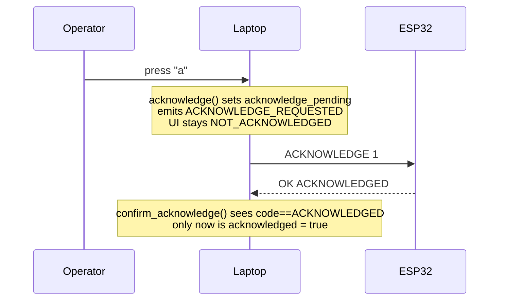
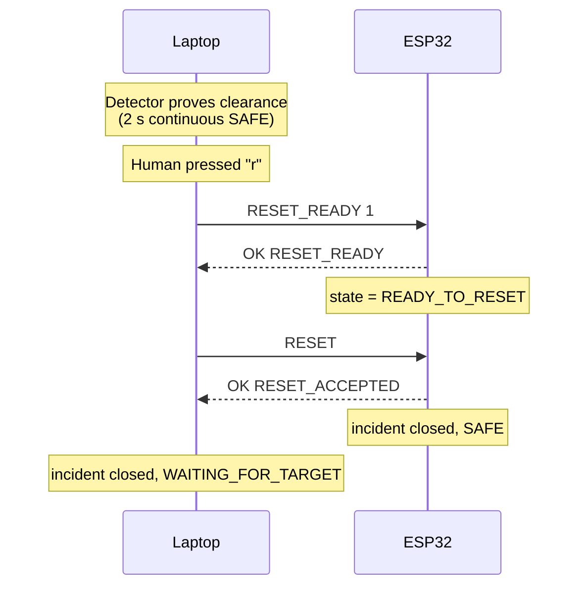

# Serial protocol

Status: **implemented** for the incident lifecycle (Phase 4A). The JSON schema
that [plan.md §8](../plan.md#8-serial-protocol) originally proposed was never
built; the shipped firmware uses a line-oriented **text** protocol instead, which
is what this document specifies.

## Why text, not JSON

The command set is small and the failure mode that matters is a human reading a
serial monitor at 2 a.m. A text protocol is readable without a parser, survives a
truncated line, and lets a stalled board be driven by hand. The JSON schema was
a draft; it is superseded, not pending.

## Transport

| Property | Value |
|---|---|
| Physical layer | USB CDC serial (ESP32-S3) |
| Baud rate | 115200 |
| Encoding | UTF-8 |
| Framing | One command per `\n`-terminated line; `CRLF` also accepted |
| Line length | 40 bytes maximum — parsed into a bounded buffer, longer input is truncated |
| Case | Commands are case-insensitive (`reset` == `RESET`) |
| Whitespace | Leading/trailing spaces and tabs are trimmed |

## Laptop → ESP32

### Lifecycle commands

| Command | Meaning | Requires an open incident? |
|---|---|---|
| `HEARTBEAT` | Proves the link is alive. Never changes state. | no |
| `INCIDENT <id>` | A confirmed violation. Latches the alarm. | no — starts one |
| `SILENCE <id>` | Mute the buzzer, red stays on. | yes |
| `ACKNOWLEDGE <id>` | A human has seen the alarm. Mutes the buzzer, **never** clears red. | yes |
| `NO_INCIDENT <id>` | Laptop's clearance verdict for a known episode. **Never** clears red and never closes the incident. | yes |
| `RESET_READY <id>` | Laptop asserts it has proven recovery. Arms the reset gate. | yes |
| `RESET` | Clear the incident. **Only** legal after `RESET_READY <id>`. | yes |
| `STATUS` | Print the human-readable block, then one machine-readable `STATUS <line>`. Read-only. | no |

`<id>` is mandatory on the id-carrying commands. `INCIDENT abc` is rejected with
`ERR BAD_ARGUMENT INCIDENT` rather than silently latching incident `0`.

Every id-carrying command is **id-checked**: a token for a different episode is
refused, so a stale or crossed command can never be applied to the wrong
incident. The id-less spellings of `SILENCE` and `ACKNOWLEDGE` still exist on the
board as legacy aliases that skip that check, so **the laptop never sends them** —
`tools/live_eye_shield_demo.py` refuses to put a bare `SILENCE` or `ACK` on the
wire at all.

`NO_INCIDENT <id>` is *not* a way to re-assert a quiet state. The firmware
refuses it when no incident is active (`ERR NO_INCIDENT_REJECTED NO_INCIDENT`),
so the laptop represents "nothing open" locally as a `WAITING` sentinel and keeps
it off the wire.

### Bring-up presets

These write the pins directly and exist for wiring checks and the `SELF_TEST`
path. They are **diagnostic overrides**, not lifecycle transitions.

| Command | Effect |
|---|---|
| `GREEN_ON` / `GREEN_OFF` | green lamp only |
| `RED_ON` / `RED_OFF` | red lamp only |
| `BUZZER_ON` / `BUZZER_OFF` | buzzer only |
| `ALL_OFF` | every output off — **refused during an open incident** |
| `SELF_TEST` / `STOP_TEST` | run / abort the 8-step non-blocking sequence |
| `HELP` (or `?`) | command list |

`SAFE`, `ALARM` and `SILENCE` are **not** presets. They were, and that was a
safety defect: `handleCommand()` consulted the preset table *before* the
lifecycle parser, so `ALARM` drove green=off/red=on/buzzer=on straight to the
pins while `IncidentCore` stayed in `FwState::Safe` with `incident_id=0`.
Nothing was latched, so the next `HEARTBEAT` re-applied `outputs()` computed from
`Safe` and turned the green lamp back on about a second later — with no
acknowledgement and no reset. Those three words now reach `IncidentCore`, which
is the only component allowed to decide what the lamps do.

**A preset is refused while an incident is open.** The operator gets
`ERR PRESET_DIAGNOSTIC_ONLY INCIDENT_ACTIVE <PRESET>` and no pin changes, so a
preset can never paint over a latched alarm. There is no override: the
diagnostic path exists for bring-up, not for silencing a real incident.

## ESP32 → laptop

### Success replies

| Reply | Emitted for |
|---|---|
| `OK HEARTBEAT` | `HEARTBEAT` |
| `OK INCIDENT` | `INCIDENT <id>` (the state change to `ALARM_LATCHED` is in `STATUS`) |
| `OK SILENCED` | `SILENCE <id>` |
| `OK ACKNOWLEDGED` | `ACKNOWLEDGE <id>` |
| `OK NO_INCIDENT` | `NO_INCIDENT <id>` |
| `OK RESET_READY` | `RESET_READY <id>` |
| `OK RESET_ACCEPTED` | `RESET` |
| `OK ALL_OFF` | `ALL_OFF` |
| `OK GREEN_ON` / `OK GREEN_OFF` / `OK RED_ON` / `OK RED_OFF` / `OK BUZZER_ON` / `OK BUZZER_OFF` | the matching pin preset |
| `OK YELLOW_OFF` / `OK YELLOW_STEADY` / `OK YELLOW_SLOW_BLINK` / `OK YELLOW_FAST_BLINK` | yellow channel, when enabled |

### Refusals

Every refusal names the reason, so the operator is told the first real blocker
instead of a generic failure.

| Reply | Cause |
|---|---|
| `ERR SAFE_REJECTED INCIDENT_ACTIVE` | `SAFE` while an incident is open |
| `ERR PRESET_DIAGNOSTIC_ONLY INCIDENT_ACTIVE <PRESET>` | any pin preset while an incident is open |
| `ERR SILENCE_REJECTED NO_INCIDENT` | `SILENCE` with nothing latched |
| `ERR ACKNOWLEDGE_REJECTED NO_INCIDENT` | `ACKNOWLEDGE` with nothing latched |
| `ERR INCIDENT_REJECTED BAD_ARGUMENT` | `INCIDENT` with a missing, zero or non-numeric id |
| `ERR INCIDENT_REJECTED ALREADY_OPEN` | `INCIDENT <id>` while a *different* id is latched |
| `ERR INCIDENT_ID_MISMATCH` | `SILENCE <id>` / `ACKNOWLEDGE <id>` for the wrong episode |
| `ERR NO_INCIDENT_REJECTED NO_INCIDENT` | `NO_INCIDENT` with nothing latched |
| `ERR NO_INCIDENT_REJECTED ID_MISMATCH` | `NO_INCIDENT <id>` for the wrong episode |
| `ERR NO_INCIDENT_REJECTED INCIDENT_STILL_OPEN` | clearance before any acknowledgement |
| `ERR RESET_REJECTED NO_INCIDENT` | `RESET` with nothing latched |
| `ERR RESET_REJECTED NOT_ACKNOWLEDGED` | no human has acknowledged |
| `ERR RESET_REJECTED NOT_SAFE_RECOVERED` | no matching `RESET_READY <id>` |
| `ERR RESET_REJECTED LINK_OR_HEALTH_INVALID` | no heartbeat within `HEARTBEAT_TIMEOUT_MS` |
| `ERR RESET_READY_REJECTED NO_INCIDENT` | `RESET_READY` with nothing latched |
| `ERR RESET_READY_REJECTED NOT_ACKNOWLEDGED` | `RESET_READY` before acknowledge |
| `ERR ALL_OFF_DIAGNOSTIC_ONLY INCIDENT_ACTIVE` | `ALL_OFF` during an incident |
| `ERR BAD_ARGUMENT <CMD>` | missing or non-numeric `<id>` |
| `ERR YELLOW_DISABLED` | yellow command while the channel is compiled out |
| `ERR UNKNOWN_COMMAND` | unrecognised token |

The `RESET` checks are **ordered**: `NO_INCIDENT` → `NOT_ACKNOWLEDGED` →
`NOT_SAFE_RECOVERED` → `LINK_OR_HEALTH_INVALID`. The operator is told the
earliest unmet precondition, which is the one they must fix first.

### The `STATUS` line

`STATUS` prints the human-readable block and then exactly one machine-readable
line, prefixed `STATUS `. The prefix is what makes it findable in a log that also
contains `OK`/`ERR` replies.

```text
STATUS STATE=ACKNOWLEDGED INCIDENT=5 ACK=1 RESET_READY=0 REARM=0 GREEN=0 RED=1 BUZZER=0 LINK=1
```

| Field | Meaning |
|---|---|
| `STATE` | `SAFE`, `ALARM_LATCHED`, `SILENCED`, `ACKNOWLEDGED`, `READY_TO_RESET`, `FAULT` |
| `INCIDENT` | open incident id, `0` when none |
| `ACK` | `1` once a human has acknowledged |
| `RESET_READY` | `1` when a matching `RESET_READY <id>` has armed the gate |
| `REARM` | how many times this episode has re-armed the buzzer |
| `GREEN` / `RED` / `BUZZER` | the outputs the core *wants* |
| `LINK` | `1` if a heartbeat arrived within `HEARTBEAT_TIMEOUT_MS` |

## Reply correlation

The laptop acts on a reply **only** if that reply answers a command it actually
sent, and only if the reply code is the one that command owes. This is what stops
a periodic `OK HEARTBEAT` from being mistaken for a confirmation. It mattered:
before correlation existed the UI showed `ACKNOWLEDGED` purely because
`acknowledge()` flipped a local flag, and a captured hardware log contained
**zero** `ACKNOWLEDG` lines while the operator was told the alarm was
acknowledged.

`tools/live_eye_shield_demo.py` keeps a single `OutstandingCommand` slot:

| Property | Behaviour |
|---|---|
| One command in flight | A second send while the slot is busy is **refused**, not queued. Queueing would let a stale reply be matched to the wrong command. |
| Expected code | `EXPECTED_REPLY_CODES` maps each command to the reply that proves it landed, e.g. `ACKNOWLEDGE → ACKNOWLEDGED`. A reply with any other code is `IGNORED` and the slot stays claimed. |
| Fire-and-forget | `HEARTBEAT` and `STATUS` never claim the slot; correlating a 1 Hz heartbeat would starve every real command. |
| Timeout | An unanswered command expires, the link is marked degraded and the operator UI goes to `FAULT`. Silence is never read as success. |

### Acknowledge is two-phase

Pressing `a` in the demo is a **request**, not a state change:



- `acknowledge()` records intent and emits `ACKNOWLEDGE_REQUESTED`. It never sets
  `acknowledged`.
- `confirm_acknowledge(reply, now, expected_incident_id)` is the **only** path to
  `acknowledged = True`, and it requires `reply.ok` **and**
  `code == "ACKNOWLEDGED"`. It returns `CONFIRMED`, `REJECTED`, `IGNORED` (wrong
  episode) or `NO_PENDING_ACK`.
- `reset_blocker()` still gates on `acknowledged`, so a reset remains impossible
  until the board has confirmed the acknowledgement. A dropped reply leaves the
  operator stuck at `NOT_ACKNOWLEDGED`, which is the safe direction to fail.

## The two-step reset handshake

Neither side alone may clear the lamp. This is the core safety property of the
protocol, so it is stated as a sequence:



- The laptop mints `RESET_READY <id>` only after its own detector proved
  recovery. The firmware then demands a **matching** token before honouring
  `RESET`, so a stale token from an earlier episode is refused.
- **A refusal must re-assert state.** If the firmware refuses, the laptop clears
  its pending token and re-sends the steady-state command for its own state.
  Otherwise a rejected reset would leave the board in `READY_TO_RESET` while the
  laptop still shows a latched incident.
- **The handshake is not drained twice.** The `RESET` half of the handshake is
  the command itself, already answered; the transition log marks it consumed so
  the ordinary command drain cannot send a second `RESET` for a closed incident.

## Link health

`HEARTBEAT_TIMEOUT_MS` (default **3000 ms**) is how the firmware proves the
laptop is still there. A crashed or unplugged laptop therefore cannot clear an
alarm: `RESET` is refused with `LINK_OR_HEALTH_INVALID`.

The demo sends `HEARTBEAT` every **1.0 s** — a third of the timeout — and
emits it *before* draining pending commands, so a burst of lifecycle traffic can
never starve the link and cause a spurious refusal.

## Yellow channel — advisory, and disabled by default

The yellow traffic-light input is **not wired** on the built hardware
(see [hardware_bringup.md](./hardware_bringup.md) §2.1). Yellow support is
compiled out unless `YELLOW_LED_ENABLED` is `1` in `config.h`, and
`STATUS` reports `yellow : DISABLED (input not wired)`.

Yellow is **advisory only**. It never gates a reset, never substitutes for red,
and is not part of any safety claim. Enabling it requires wiring the input and
recording the measurement first.

## Reliability commitments

- A confirmed physical alarm stays latched even if the laptop application exits.
  The demo deliberately does **not** send `ALL_OFF` on shutdown.
- A serial disconnect never clears a latched incident.
- The laptop never displays "safe" without a fresh, valid observation from its
  own detector — and never asserts `SAFE` to the board on the strength of
  recovery alone. Recovery returns the operator to `WAITING_FOR_TARGET`.
- Every command is answered with exactly one `OK` or `ERR` line, so a silent
  serial monitor always means a dead link rather than a slow reply.

## Where this is implemented and tested

| Layer | File | Tests |
|---|---|---|
| Firmware state machine (Arduino-free) | `firmware/esp32_eye_shield_monitor/incident_core.h` | `tests/test_incident_core.py` (58) |
| Firmware sketch (pins, framing, preset guard) | `firmware/esp32_eye_shield_monitor/esp32_eye_shield_monitor.ino` | `tests/test_sketch_preset_guard.py` (6), and compiles for `esp32:esp32:esp32s3` |
| Operator lifecycle | `tools/incident_lifecycle.py` | `tests/test_incident_lifecycle.py` (42) |
| Reply correlation and two-phase ACK | `tools/live_eye_shield_demo.py` | `tests/test_serial_correlation.py` (41) |
| Operator UI | `tools/live_eye_shield_demo.py` | `tests/test_live_eye_shield_timer.py` (27) |
